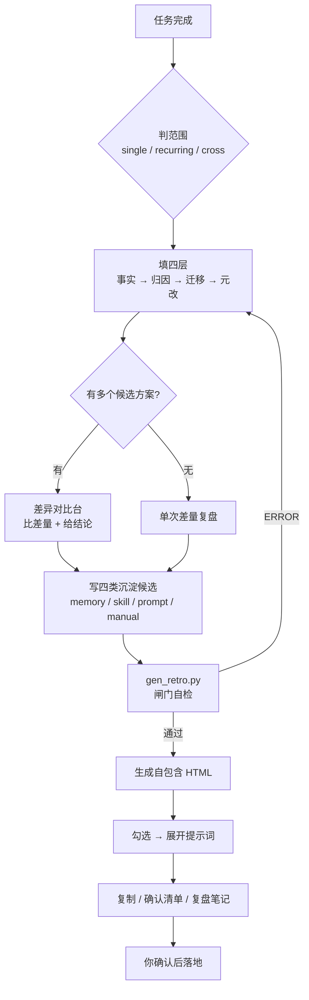

# task-retro-confirm · 任务复盘沉淀器

> 任务干完了，别让经验烂在这次对话里。**四层复盘 → 四类沉淀 → 勾选落地。**

把一次任务的经验整理成一张**可勾选、勾选即展开可执行提示词**的自包含 HTML 确认页。

本页只做确认，**不自动写记忆、不自动改提示词、不自动建 Skill**——你勾完复制、确认后再执行。


---

## 为什么需要它

复盘最常见的三种死法，这个工具各有一道闸拦着：

| 死法 | 症状 | 拦它的闸 |
|------|------|----------|
| **自说自话** | 写「应该注意 xx」，没有任何结果支撑 | **证据闸**：每条必须挂依据，无证据不上榜 |
| **越写越多** | 20 条"经验"，下次一条都不看 | **收敛闸**：成品笔记 ≤5 条，装不下就拆 |
| **沉淀错层** | 一次性巧合写进长期记忆，污染后续判断 | **范围闸**：先判单次/重复/通用，再决定沉哪层 |

一句话：**不追求写得多，追求下次开工时 30 秒能读完并且真能用上。**

---

## 四层复盘（深度）

只写"发生了什么"是流水账。四层递进，缺层会在页面上标出来：

| 层 | 名称 | 必答 | 产物 |
|----|------|------|------|
| **L1** | 事实层 | 目标与实际差多少？ | 有效做法（带证据，≤3 条） |
| **L2** | 归因层 | 弯路的根因属于哪一类？ | 根因四选一（≤2 条） |
| **L3** | 迁移层 | 下次同类任务第一步做什么？ | **一句可执行的动作** |
| **L4** | 元改层 | Harness 哪一环该改？ | 指向具体沉淀类型 |

**L3 是最容易被跳过、也最值钱的一层。** 没有"下次第一步"，所有结论都停在纸面。

L2 的根因必须归到四类之一，不许写"沟通不畅"这种糊话——因为四类的对策完全不同：

| 根因 | 含义 | 对策方向 |
|------|------|----------|
| `信息缺失` | 当时根本不知道 | 补上下文 / 先盘点 |
| `判断错误` | 知道但判错了 | 改判据 / 加决策清单 |
| `执行失误` | 判对但做错 | 加校验 / 自动化 |
| `工具缺陷` | 流程对但工具卡住 | 换工具 / 加兜底 |

---

## 四类沉淀（范围）

不要什么都往记忆里塞。按 **Harness 组件**切分——改的是哪一环，就沉到哪一层：

| 类型 | 中文 | 沉到哪 | 一句话判据 |
|------|------|--------|-----------|
| `memory` | 记忆 | `MEMORY.md` | 这件事**是什么**（事实/口径/铁律） |
| `skill` | 技能 | `skills/<name>/` | 这件事**怎么做**（可复用流程） |
| `prompt` | 提示词 | 提示词模板库 | 这句话**怎么说**（表达方式） |
| `manual` | 改进手册 | playbook | 这类事**为什么这么做**（方法论） |

再叠加**范围判定**，防止过度泛化：

```
这次经验下次还会用到吗？
├─ 不会（单次）──────────► single   沉淀上限 1 条，只允许提示词类
└─ 会
   ├─ 只在某类任务里 ────► recurring 主力：memory + skill
   └─ 与领域无关 ────────► cross     主力：manual + 全局 memory
```

> **单次任务往长期记忆里塞东西，是最常见的污染源**——`single` 场景下写非提示词类，脚本会警告。

---

## Harness² 差异对比台

> Harness = 模型之外那套配置：**提示词、工具、记忆、技能**。
> 复盘真正该改的是这四样，而不是"下次更努力"。

学习的原料是**差量**。同一个任务用不同配置跑一遍，两次的差异本身就是答案——不需要标准答案，也不需要打分器。

页面内置对比台：填维度 + 各方案表现 + 结论。

```
核心问题：页面视觉验收用哪种方式？
┌──────────────────┬──────────┬──────────┬────────────┬────────┐
│ 方案 / 维度      │ 发现问题 │ 耗时     │ 覆盖风险   │ 可重复 │
├──────────────────┼──────────┼──────────┼────────────┼────────┤
│ A. 只看 1600×900 │ 0 个     │ 1 次截图 │ 窄屏全漏   │ 低     │
│ B. 三档截图      │ 3 个     │ 3 次截图 │ 覆盖三类屏 │ 高     │
└──────────────────┴──────────┴──────────┴────────────┴────────┘
结论：选 B。多 2 次截图的成本，换来 3 个真实布局缺陷。
```

**填写要点**：不比绝对分只比差量 · 维度必须包含代价 · 必须给结论（不给会警告）。

---

## 工作流



---

## 快速开始

### 1. 写一个 `items.json`

最小可用结构：

```json
{
  "title": "任务复盘 · 待确认事项",
  "task": "一句话描述这次的任务",
  "scope": "recurring",
  "findings": {
    "worked": [
      { "text": "管用的做法", "evidence": "凭什么说它管用" }
    ],
    "detours": [
      { "text": "走的弯路", "rootCause": "判断错误", "fix": "下次怎么避开" }
    ],
    "firstStep": "下次开工的第一个动作",
    "meta": "Harness 哪一环该改"
  },
  "items": [
    {
      "id": "M1",
      "type": "memory",
      "title": "候选标题",
      "why": "为什么值得沉淀",
      "evidence": "依据",
      "confidence": "high",
      "scope": "cross",
      "prompt": "可执行的完整提示词"
    }
  ]
}
```

多方案场景再加 `variants` 字段（见 `references/sample_items.json`）。

### 2. 先校验，再生成

```bash
# 只校验不生成，看闸门有没有拦住问题
python scripts/gen_retro.py items.json --check

# 通过后生成
python scripts/gen_retro.py items.json out.html
```

### 3. 打开 `out.html`，勾选 → 复制 → 确认后落地

> 不想写 JSON？直接改 `references/skeleton.html` 里的 `__DATA__` 占位符也能用。

---

## 页面能力

| 按钮 | 作用 |
|------|------|
| **复制复盘笔记** | 输出 ≤5 条成品笔记，下次开工前直接喂给 AI |
| **复制复盘提示词** | 输出**通用复盘模板**，下次同类任务开工前复用 |
| **复制已勾选提示词** | 批量复制所有勾选项 |
| **生成确认清单** | 按四类分组汇总成一段可直接执行的指令 |

顶部有 **6 个闸门仪表**：有效做法 x/3、弯路 x/2、笔记合计 x/5、证据覆盖率、"待验证"数、已滤除数。
一眼就能看出这次复盘够不够硬。

---

## 闸门自检规则

`gen_retro.py` 会在生成前跑一遍检查：

| 级别 | 触发条件 | 行为 |
|------|----------|------|
| `ERROR` | `type` 非法 / 缺 `prompt` | **阻断生成**，必须修 |
| `WARN` | 条数超限 / 缺证据 / 根因不在四类 / `scope` 非法 / `variants` 缺结论或维度不匹配 / `single` 场景写非提示词类 | 提示，可继续 |
| 自动处理 | `confidence = "low"` | **剔除入页**，但在"已滤除"仪表里留痕 |

**关键口径**：成品笔记 = 做法 + 弯路 + **下次第一步**，合计 ≤5。
因为"下次第一步"本身就是一条，所以实际上 `worked + detours ≤ 4`。

---

## 文件结构

```
task-retro-confirm/
├── SKILL.md                     # 技能说明（设计初衷 / 四层 / 四类 / 铁律）
├── scripts/
│   └── gen_retro.py             # 生成器：闸门自检 + 注入骨架（仅标准库）
├── references/
│   ├── skeleton.html            # 自包含 HTML 骨架（CSS/JS 全内联，3 处占位符）
│   ├── retro-framework.md       # 方法论细则：判定标准 / 好坏例 / 判定树
│   └── sample_items.json        # v2 完整样例（含 findings / variants / 四类候选）
├── examples/
│   └── demo.html                # 生成后的演示页
└── assets/
    └── preview.png              # 上图预览截图
```

---

## 提示词撰写约定

| 类型 | 开头格式 | 正文要点 |
|------|----------|----------|
| 记忆 | `【写入长期记忆】` + 真实 `.workbuddy` 路径 | 二级标题分段，只写事实与口径，不写叙事 |
| 技能 | `【创建 Skill】名称：xxx` | 触发条件 / 输入参数 / 流程 / 交付物 / 验收标准 |
| 提示词 | `【优化提示词】` | **改前 / 改后对照**，并说明触发这次修改的失败现象 |
| 改进手册 | `【写入改进手册】` | 适用场景 → 做法 → 反例边界，三段式 |

所有提示词必须**自包含可执行**：复制后粘到任何对话都能照做，不依赖本次上下文。

---

## 铁律

- **不编证据**——结果里没有的，不写成"验证过"
- **不超 5 条**——装不下说明还没想清楚，不是经验太多
- **不上低把握项**——`confidence=low` 不进入页面
- **一项一改**——一条候选只改 Harness 的一环，混装会让你无法判断该不该勾
- **不替你拍板**——页面只承载候选与提示词，落地动作等你明确指令

---

## License

MIT © 卢克先生 / Mr.Luke
