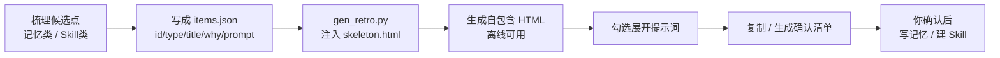
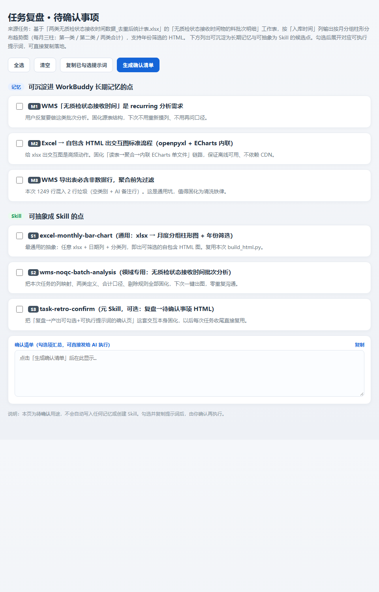

# task-retro-confirm · 任务复盘待确认事项生成器

把一次任务里「值得沉淀进长期记忆的点」和「值得抽象成 Skill 的点」，整理成一张**可勾选、勾选即展开可执行提示词**的自包含 HTML 确认页。

> 本页只做确认，**不自动写任何记忆、不自动建 Skill**——你勾完复制、再让我「把勾中的落地」才执行。

---

## 它能做什么

- 候选项分两组：**记忆类**（可写进 `MEMORY.md`）/ **Skill 类**（可建 WorkBuddy skill）
- 勾选任一项 → 展开对应「可执行提示词」文本框（写记忆 / 建 skill 的具体指令）
- 工具栏：**全选 / 清空 / 复制已勾选提示词 / 生成确认清单**
- 「生成确认清单」把勾选项汇总成一段可直接发给 AI 执行的文本，单条和整段都能一键复制
- **纯前端、零依赖、离线可用**（无 CDN、无外链图）

## 什么时候用

- 「复盘一下这次能沉淀什么」「给个待确认清单」「把可复用点整理成确认页」
- 任何较复杂任务收尾，需要把经验固化为记忆或 Skill，但想先让你拍板、不想直接动手

## 快速开始

1. 复制 `references/sample_items.json`，改成你这次任务的候选点（字段：`id` / `type` 取 `memory` 或 `skill` / `title` / `why` / `prompt`）。
2. 运行生成器：

```bash
PY="C:/Users/Sxg/.workbuddy/binaries/python/versions/3.13.12/python.exe"
"$PY" scripts/gen_retro.py items.json out.html
```

3. 打开 `out.html`，勾选 → 复制提示词 → 确认后执行。

> 不想写 JSON？直接复制 `references/skeleton.html`，把 `const RETRO_DATA = __DATA__;` 换成 `{"items":[...]}`，并替换 `__TITLE__` / `__LEAD__` 即可。

## 工作流



## 预览

打开 `examples/demo.html` 即见效果（与下方截图同构）：



## 文件结构

```
task-retro-confirm/
├── SKILL.md                     # 技能说明（触发场景 / 使用流程）
├── scripts/
│   └── gen_retro.py             # 读 items.json → 注入骨架 → 产出自包含 HTML（仅标准库）
├── references/
│   ├── skeleton.html            # 自包含 HTML 骨架（含完整 CSS/JS，三处占位符）
│   └── sample_items.json        # 完整样例（记忆类 M1–M3 / Skill 类 S1–S3）
├── examples/
│   └── demo.html                # 生成后的演示页
└── assets/
    └── preview.png              # 上图预览截图
```

## 提示词撰写约定（写进 `prompt` 字段）

- **记忆类**：开头写明「【写入长期记忆】请追加到用户级 MEMORY.md（路径用真实 `.workbuddy` 路径）」，正文用 Markdown 二级标题分段。
- **建 Skill 类**：开头写明「【创建 Skill】名称：xxx」，正文给触发场景、输入参数、流程步骤、交付物。
- 提示词必须**自包含、可直接执行**——复制后粘给任意 AI Agent 平台都能照做，不依赖当前对话上下文。

## License

MIT © 卢克先生 / Mr.Luke
